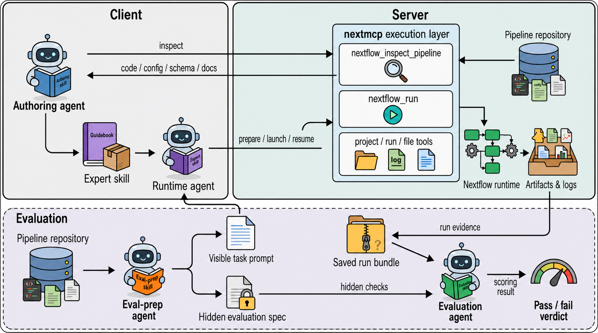

# NextMCP

**An agent-oriented framework built on the Model Context Protocol that separates pipeline-agnostic execution control from pipeline-specific expertise.**

NextMCP connects an AI agent on a client computer to a controlled Nextflow execution interface on an analysis server.
The server provides a common execution layer for preparing launches, tracking runs,
inspecting outputs, and recovering from failures. Client-side expert skills guide
pipeline-specific input selection, parameter choices, quality control, and troubleshooting.

[Installation](#installation) · [Configuration](#configuration) ·
[Connect a client](#connect-a-client) · [Expert skills](#expert-skills) ·
[First analysis](#first-analysis) · [Authoring and evaluation](#authoring-and-evaluation)



*The panel illustrates the client–server architecture, comprising a pipeline-agnostic execution layer for Nextflow and client-side expert skills. An authoring agent retrieves pipeline source materials through the execution layer to generate pipeline-specific expert skills, which guide the runtime agent in configuring and executing existing pipelines. The execution layer provides controlled pipeline inspection, workflow preparation, launching, monitoring and resumption, together with restricted filesystem access and persistent project-level run records. The lower panel illustrates the evaluation workflow used in this study. An evaluation-preparation agent derives visible task prompts and hidden evaluation specifications from pipeline repository materials. Visible prompts were provided to the runtime agent, whereas hidden specifications were withheld from it and used by the evaluator after execution. A separate evaluation agent assesses saved run evidence against predefined criteria for task-to-configuration fidelity, execution completion and required-output presence. Skill authoring and evaluation are performed separately from runtime workflow execution.*

## What NextMCP provides

- **Preparation:** inspect a normalized launch plan, path checks, and run locations before starting Nextflow.
- **Execution:** launch versioned workflows in project-owned directories and record their state.
- **Inspection:** retrieve progress, logs, outputs, and diagnostic summaries through MCP tools.
- **Recovery:** inspect a previous run and request a restart using its recorded identifier.
- **Pipeline guidance:** use client-side skills for parameters, output review, and assay-specific QC.

NextMCP leaves workflow execution to Nextflow and the selected pipeline. It does not expose
a general shell-command tool. File tools enforce configured path permissions; these controls
do not sandbox all workflow code. Compute allocation, container availability, reference
selection, and scientific interpretation remain deployment or user responsibilities.

## Deployment model

| Location | Components | Role |
| --- | --- | --- |
| Server | NextMCP, Nextflow, Java, container runtime, inputs and references | Execute workflows and store run records, logs, and results |
| Client computer | Codex or Claude Code, expert skills | Interpret requests and call MCP tools |
| SSH connection, when needed | Local port forwarding | Reach a server bound to loopback |

Installing a client skill does not install a pipeline on the server. Nextflow resolves
remote workflow identifiers. This deployment does not require a vendored pipeline directory.

## Installation

### 1. Prepare the server

Use Linux with Conda and a container runtime supported by the selected pipeline.
This example uses Java 21 and Nextflow 25.10.2:

```bash
# Set Up the Environment
conda create -n nextmcp -c conda-forge -c bioconda python=3.12 openjdk=21 nextflow=25.10.2 -y

# Activate Environment
conda activate nextmcp

# Install UV
python -m pip install uv

# Verify Tools
java -version
nextflow -version
command -v nextflow
```

See the
[Nextflow installation documentation](https://docs.seqera.io/nextflow/install).

```bash
# Verify that Docker is installed and ready to use
docker info
```

### 2. Install NextMCP

```bash
# Clone the NextMCP repository
git clone https://github.com/wanghwlab/NextMCP.git
# Navigate into the project directory
cd NextMCP
# Install dependencies and create the virtual environment
uv sync --locked
# Create the local configuration file from the example
cp config/config.example.yaml config/config.yaml
```

## Configuration

Edit configuration before starting. The template contains deployment placeholders;
copying it alone is not a complete configuration.

See the [configuration reference](config/README.md) for every field.

| Setting | Meaning |
| --- | --- |
| `allowed_read_roots` / `allowed_write_roots` | Directories permitted by server file/path checks; client paths are not server paths |
| `state.db_path` | SQLite process-record database, created by the service |
| `projects.root` | Parent directory for analysis projects and runs |
| `default_profile` | Default launch profile; the pipeline and installed runtime must support it |
| `expose_pipeline_materials` | Enable full local source/documentation inspection for authoring |
| `NXF_HOME` | Nextflow home directory, including its default downloaded-pipeline location |
| `NXF_OFFLINE` | When true, restrict Nextflow repository and plugin downloads |
| `NXF_VER` | Version selection for Nextflow launchers that honor it; keep consistent with the installed runtime |

Supply explicit reference parameters when using local references.
Quote environment-variable values as strings in YAML. See the
[Nextflow environment-variable reference](https://docs.seqera.io/nextflow/reference/env-vars).

### Validate and start

After replacing paths, create the corresponding writable directories. For this example:

```bash
mkdir -p /srv/nextmcp/state /srv/nextmcp/projects /srv/nextmcp/logs /srv/nextmcp/.nextflow
# Validate config only
uv run nextmcp --config config/config.yaml --check-config
# Print effective config with secrets redacted
uv run nextmcp --config config/config.yaml --dump-config
# Run
uv run nextmcp --config config/config.yaml
```

With this configuration, the MCP endpoint is **http://127.0.0.1:8321/mcp**. The example
template uses the same 127.0.0.1:8321 listener; always use your effective host and port.
Keep the service running in a persistent terminal or managed service. 

## Connect a client

Install and sign in to [Codex](https://developers.openai.com/codex/) or
[Claude Code](https://code.claude.com/docs/en/setup) on the client computer.

### 1. Open the SSH tunnel

In a terminal on the **client computer**, replace USER and SERVER:

```bash
ssh -N -T -p 22 -o ExitOnForwardFailure=yes -o ServerAliveInterval=60 -o ServerAliveCountMax=3 -L 127.0.0.1:8321:127.0.0.1:8321 USER@SERVER
```

A successful connection normally remains
open without a shell prompt. Keep the window open; closing it disconnects the tunnel.

*The SSH password is the server account's login password. The MCP bearer token is a separate
credential from the server configuration. They are not interchangeable.*
*Skip the tunnel if the client runs on the server itself. For an independently configured
HTTPS deployment, use its reachable MCP URL. Each additional client computer needs its own
connection, client configuration, token access, and installed skills.*

### 2. Make the MCP token

Open a **second client terminal**. Read the actual server token without placing it in command
history.

Windows PowerShell:

```powershell
$tokenInput = Read-Host "NextMCP bearer token" -AsSecureString
$env:NEXTMCP_TOKEN = [System.Net.NetworkCredential]::new("", $tokenInput).Password
Remove-Variable tokenInput
```

Bash on Linux/macOS:

```bash
read -rsp 'NextMCP bearer token: ' NEXTMCP_TOKEN
echo
export NEXTMCP_TOKEN
```

These variables apply to this terminal and processes started from it. Repeat the step in
a new terminal.

### 3a. Codex

Run in the terminal containing `NEXTMCP_TOKEN`:

```bash
codex mcp add nextmcp --url http://127.0.0.1:8321/mcp --bearer-token-env-var NEXTMCP_TOKEN
codex mcp get nextmcp
codex mcp list
codex
```
*In Codex CLI, use `/mcp` to inspect the connection,
then request the `server_info` tool. See the
[official Codex MCP documentation](https://developers.openai.com/codex/mcp/).*

### 3b. Claude Code

Run in the terminal containing `NEXTMCP_TOKEN`:

```bash
claude mcp add --transport http --scope user nextmcp http://127.0.0.1:8321/mcp --header 'Authorization: Bearer ${NEXTMCP_TOKEN}'
claude mcp get nextmcp
claude mcp list
claude
```
*In Claude Code, use `/mcp` to inspect the connection.
See the [official Claude Code MCP documentation](https://code.claude.com/docs/en/mcp).*

## Expert skills

These are the current package targets.

| Pipeline | Version |
| --- | --- |
| fetchngs | 1.12.0 |
| rnaseq | 3.22.2 |
| riboseq | 2.0.0 |
| ampliseq | 2.16.1 |
| atacseq | 2.1.2 |
| chipseq | 2.1.0 |
| epitopeprediction | 3.1.0 |
| mag | 5.4.2 |
| methylseq | 4.2.0 |
| nanoseq | 3.1.0 |
| rnafusion | 4.1.0 |
| sarek | 3.8.1 |
| scrnaseq | 4.1.0 |

### Install on the client

Obtain a repository copy on the client. Install complete expert skill directories, including
`SKILL.md`, assets, and references. Keep evals in the source distribution for maintenance;

| Client | User-wide skill directory |
| --- | --- |
| Codex | `~/.agents/skills/` |
| Claude Code | `~/.claude/skills/` |

See the official [Codex skill locations](https://developers.openai.com/codex/skills/)
and [Claude Code skill locations](https://code.claude.com/docs/en/skills).

For authoring or evaluation, also install the selected package from skills/meta using the
same directory layout. The contract builder needs all four pipeline-test-* packages.
See the [meta skill guide](skills/meta/README.md) for their roles and examples.

## First analysis

### Prepare an RNA-seq request

Place the samplesheet, reads, and references on the server within readable directories.
Confirm that the samplesheet uses server paths. In Codex, select or mention
`$rnaseq-expert-skill`; in Claude Code, invoke `/rnaseq-expert-skill` or request it by name.

```text
# Then provide a task such as:
Use rnaseq-expert-skill and nextmcp to prepare nf-core/rnaseq 3.22.2.
Project: rnaseq-demo
Samplesheet: /srv/data/rnaseq/samplesheet.csv
Genome FASTA: /srv/references/genome.fa
Annotation GTF: /srv/references/genes.gtf
Use STAR-Salmon and the server's configured container profile.
Check server files and the samplesheet. Return the prepared launch plan and
output locations. Do not launch until I have reviewed the plan.
```

The paths are examples, not included datasets. The corresponding MCP tool arguments could be:

```json
{
  "project": "rnaseq-demo",
  "pipeline": "nf-core/rnaseq",
  "extra_args": ["-r", "3.22.2"],
  "params": {
    "input": "/srv/data/rnaseq/samplesheet.csv",
    "fasta": "/srv/references/genome.fa",
    "gtf": "/srv/references/genes.gtf",
    "aligner": "star_salmon"
  },
  "prepare": true
}
```

This JSON describes a `nextflow_run` tool call, not a shell command. Preparation does not run
Nextflow, download the remote workflow, or verify biological suitability.

### Records and results

the default layout is:

```text
/srv/nextmcp/
├── state/processes.db
├── logs/audit.log
└── projects/<project>/
    ├── project.json
    ├── runs/<run_id>/
    │   ├── run.json
    │   ├── generated_configs/
    │   ├── job/
    │   └── work/
    └── results/<run_id>/
```

## Skills Authoring and evaluation

Use [pipeline-expert-skill-creator](skills/meta/pipeline-expert-skill-creator/SKILL.md)
to create or update a package from a selected official pipeline release:

1. Obtain the exact release's schema, workflow code, configuration, and documentation.
2. Record version and source provenance; retain applicable existing knowledge.
3. Update parameters, prerequisites, output conditions, QC, and explicit knowledge gaps.
4. Validate the package and evaluate its answers without launching Nextflow.
5. Review changes, back up the installed skill, and install the accepted package on the client.

Authoring from a separate checkout does not require server-side material inspection or
upgrading a workflow used by an existing run. Scaffolding scripts produce editable starting
packages; they do not complete scientific review automatically.

```bash
uv run python skills/meta/pipeline-expert-skill-creator/scripts/validate_expert_skill.py \
  --skill-root skills/experts/rnaseq-expert-skill
```

Each expert package's `evals/evals.json` contains evaluation prompts and assertions. Generated
answers and scores belong in a separate workspace. Offline evaluation means no real workflow
execution; a model CLI may still contact its provider. Heuristic grading and static validation
do not establish biological correctness. See the
[evaluation guide](skills/experts/README.md) for package contents and limitations.

To evaluate all 13 current expert skills with an authenticated Codex CLI, run in Bash:

```bash
bash skills/experts/all_evals.sh
```

This requests gpt-6-astra explicitly and writes new results under evaluation-output/.
It starts independent model sessions.
The model generates answers and local heuristic rules grade them. Model access is required;
the script does not silently substitute another model. Use `--dry-run` to create deliberately
failing placeholders without invoking a model. Configure an evaluation client without live
analysis MCP connections. Full options and a PowerShell single-package example are in the
[expert evaluation guide](skills/experts/README.md#evaluate-all-13-skills).

The [meta skills](skills/meta/README.md) also support visible tasks, hidden evaluation
specifications, and run-level assessment. These are separate from ordinary analysis and
question-based skill checks.

The [authoring guide](skills/meta/README.md#generate-or-update-an-expert-skill) provides
source collection, staged generation, validation, evaluation, and client replacement
commands. It also explains the six meta skills and the distinction between offline
questions and tests that require completed workflow evidence.

## Development

```bash
uv sync --locked --extra dev
uv run ruff format .
uv run ruff check .
uv run mypy src/nextmcp
uv run pytest
```

`uv sync --extra dev` includes the optional development dependencies such as pytest;
`--locked` also prevents an implicit lockfile update. `uv run pytest` runs the test suite
inside the project environment. Ordinary analysis does not require running these tests.

Tests cover service behavior, file permissions, launch handling, and skill maintenance.
Schema checks cover packaged group consistency and generator behavior using a small
synthetic schema. They do not establish complete coverage of an upstream release. Workflow-task definitions
under tests/pipeline_support are separate from expert-skill questions. See the
[test directory guide](tests/README.md) for each module, retained task inputs, and the
scope and limitations of these checks.

## License

MIT. See [LICENSE](LICENSE).
