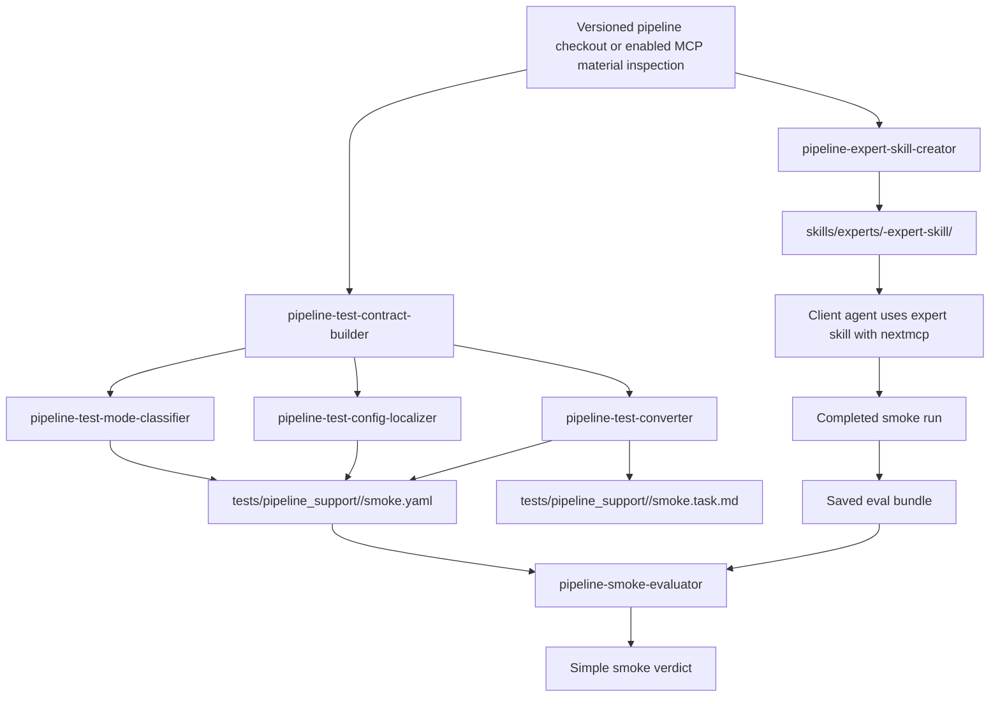

# Repository Skill Sources

This directory stores repository-side skill source packages.

It is not part of the `nextmcp` server runtime:

- the server does not discover this directory
- the server does not expose these skills through MCP tools
- completed skills must still be installed on the client side, under
  `~/.agents/skills/` for Codex or `~/.claude/skills/` for Claude Code

Current layout is class-based:

- `skills/experts/` for pipeline-specific expert skills
- `skills/meta/` for skill-generation and maintenance skills

## Relationship Map

This flow has three main paths:

- build or refresh one expert skill from pipeline materials
- build one smoke contract from upstream pipeline tests
- evaluate one completed smoke run against its hidden contract

This repository does not currently ship a concrete operator skill source package.
Generic nextmcp usage guidance is carried by the MCP tool docstrings instead.

Current source packages:

- `skills/experts/ampliseq-expert-skill/`
- `skills/experts/atacseq-expert-skill/`
- `skills/experts/chipseq-expert-skill/`
- `skills/experts/epitopeprediction-expert-skill/`
- `skills/experts/fetchngs-expert-skill/`
- `skills/experts/mag-expert-skill/`
- `skills/experts/methylseq-expert-skill/`
- `skills/experts/nanoseq-expert-skill/`
- `skills/experts/rnaseq-expert-skill/`
- `skills/experts/rnafusion-expert-skill/`
- `skills/experts/riboseq-expert-skill/`
- `skills/experts/sarek-expert-skill/`
- `skills/experts/scrnaseq-expert-skill/`
- `skills/meta/pipeline-expert-skill-creator/`
- `skills/meta/pipeline-smoke-evaluator/`
- `skills/meta/pipeline-test-config-localizer/`
- `skills/meta/pipeline-test-contract-builder/`
- `skills/meta/pipeline-test-converter/`
- `skills/meta/pipeline-test-mode-classifier/`

Use the existing `skills/` source packages as the starting point, or generate a new package with
`skill-creator` plus `pipeline-expert-skill-creator`.

See the [expert package guide](experts/README.md) for current versions, offline questions,
and the all-13 evaluation script. See the [meta skill guide](meta/README.md) for generation,
updates, test preparation, and installation. Generated workspaces and saved responses are
not source packages.
